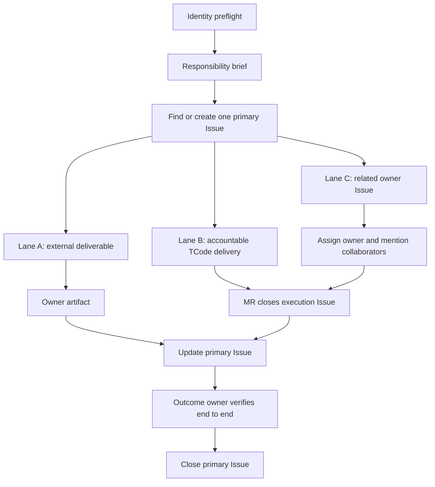

# Overview — Issue-Centered Handoff

Read this for the coordination model. Responsibility reasoning lives in
`ownership-context.md`; execution flow lives in `lanes-and-flow.md`.

## The friction it removes

TCode work often crosses standing responsibilities. A backend owner may carry frontend work for a
specific delivery, a module owner may join platform architecture, and a repository owner may help a
module close an integration gap. The team needs a workflow that preserves the person's identity and
standing responsibilities while making the current delivery responsibility explicit.

The team also uses GitLab Issues and MRs as its daily collaboration surface. Coordination stays
current when assignment, mentions, decisions, implementation, and review live where the team is
already working.

Mate removes four recurring frictions:

- Work area is mistaken for a person's team identity.
- A receiver gets a request with little reproduction context or acceptance criteria.
- Responsibility is implied by paths and remains invisible to the people involved.
- Coordination state is copied into repository documents that require separate maintenance.

## Source-of-truth hierarchy

| Information | Primary location | Purpose |
| --- | --- | --- |
| Personal identity and standing responsibilities | `TEAM.md` | identify the collaborator and durable responsibility context |
| One cross-responsibility outcome | primary GitLab Issue | handoff context, outcome owner, related work, status, acceptance |
| Independently accountable workstream | related GitLab Issue | assignee, contributors, scope, acceptance, scheduling |
| Implementation and review | MR | code, decisions, validation, review, closure |
| Durable reusable knowledge | repository document | contracts, ADRs, operating guidance, production evidence |

Existing `docs/handoff/packages/` files remain historical evidence. New coordination begins in an
Issue. A repository document is created when its content will guide future work beyond the current
Issue lifecycle.

## Lifecycle

## Primary and related Issues

One original request has one primary Issue. It preserves the end-to-end outcome and avoids a chain
of disconnected handoffs.

Create a related execution Issue when a workstream has any of these properties:

- a different accountable owner;
- an independent schedule or backlog decision;
- a separate implementation MR;
- a distinct acceptance or review responsibility;
- a dependency that the primary Issue needs to track explicitly.

The primary Issue owns the overall checklist. Each related Issue names its assignee, mentions
contributors and reviewers, links back to the primary Issue, and closes through its own MR.

## Document policy

Repository documents carry knowledge that remains useful after the Issue closes:

- a shared contract or schema;
- an architecture decision;
- a deployment or operating procedure;
- a reusable integration guide;
- production evidence that future diagnosis or audit needs.

The Issue links the document and states why it is durable. Status, assignment, reminders, routine
progress, and implementation discussion remain in Issues and MRs.

## Where the detail lives

- `ownership-context.md` — identity, responsibility signals, confidence, and human correction.
- `lanes-and-flow.md` — collaboration shapes, requester flow, receiver flow, and closure.
- `handoff-template.md` — primary and related Issue templates.
- `collab-suite.md` — companion skill responsibilities and automation posture.
- `../examples/` — a worked Issue-centered example.
